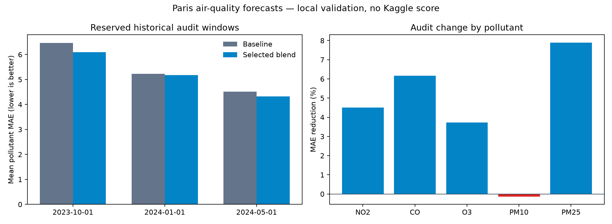

# Paris air-quality forecasting

Reproducible forecasts for the [X/HEC Paris air-quality challenge](https://www.kaggle.com/competitions/x-hec-ts-2025-predicting-air-quality-in-paris). The task is to predict 504 hourly values for NO₂, CO, O₃, PM10 and PM2.5. The challenge scores the mean of five pollutant-specific MAEs. It closed on **October 15, 2025**, so this repository reports local backtests rather than a current leaderboard rank.

## Pollutant-history-only assignment

The [executed notebook](notebooks/paris_air_quality_assignment.ipynb) and
[short report](docs/assignment/report.pdf) compare persistence, a 168-hour seasonal
naive forecast, a dataset-trained LSTM, and independent and joint zero-shot
Chronos-2 forecasts. This is a separate protocol from the weather-enabled Kaggle
study below: it does **not** use observed weather from the validation or test period.
Each method forecasts the same final 504 training hours using only earlier pollutant
observations. Missing validation labels are excluded from the corresponding MAE.

| Method | Mean validation MAE | NO2 | CO | O3 | PM10 | PM2.5 |
| --- | ---: | ---: | ---: | ---: | ---: | ---: |
| Chronos-2, independent | **5.701** | 7.206 | 0.046 | 12.970 | 5.054 | 3.228 |
| Chronos-2, joint | 5.854 | 7.451 | 0.041 | 13.106 | 5.315 | 3.359 |
| Joint LSTM | 6.504 | 7.700 | 0.032 | 16.348 | 5.158 | 3.282 |
| Persistence | 6.699 | 7.429 | 0.046 | 16.160 | 5.622 | 4.237 |
| Seasonal naive, 168 hours | 6.872 | 7.429 | 0.044 | 17.290 | 6.044 | 3.555 |

These are local results on **one** 21-day validation window, so they do not
establish performance across seasons or a Kaggle rank. The independent
Chronos-2 forecast was selected by mean validation MAE and exported as the
[assignment submission](deliverables/assignment_submission.csv). The [complete report](docs/assignment/report.md)
contains figures, weekly errors, model settings, resource measurements, and
limitations. The notebook is ready for Google Colab but the recorded run used a
local RTX 4050; a Colab run is not claimed.

To reproduce, place the original competition ZIP at `data/raw/competition.zip`,
install the optional dependencies, and run:

```bash
python -m pip install -e ".[dev,assignment]"
python -m paris_air_quality.assignment
python -m paris_air_quality.assignment_report
python scripts/render_assignment_pdf.py
```

The Chronos-2 checkpoint revision is pinned in
[`assignment.py`](src/paris_air_quality/assignment.py). The
[validation record](results/assignment_validation.json) includes exact scores,
settings, runtimes, and the input ZIP hash. Intermediate forecasts and caches
stay under the ignored `outputs/assignment/` directory; raw competition data is
never committed.

## Approach

The initial experiments compare a seasonal median, a calendar-and-history LightGBM model, and a weather-aware LightGBM model. Each model forecasts the entire 21-day window directly. Pollution lag features begin at 504 hours, so every value they read is known at the forecast origin. ERA5 weather for Paris comes from [Open-Meteo's historical weather API](https://open-meteo.com/en/docs/historical-weather-api); the challenge explicitly permits weather for the test period as if perfectly forecast. No pollutant measurements from the test period are used.

Four rolling-origin backtests use complete 504-hour windows. Missing historical pollutant labels are omitted from each pollutant's MAE. Results are local validation estimates, not hidden-test results.

| Method | Mean five-pollutant MAE |
| --- | ---: |
| Seasonal median | 7.255 |
| LightGBM, calendar and safe pollutant lags | 6.875 |
| LightGBM, calendar, lags and ERA5 weather | **4.885** |

The weather model improves the local mean by about 33% relative to the seasonal median. [Per-fold and per-pollutant results](results/backtest.json) show where it helps and where errors remain high, especially O₃ and NO₂. Short weather lags improved all four backtests relative to the initial weather model (4.925), but this feature choice used those same windows. The validation windows are not independent and the result does not establish leaderboard performance.

## Further model experiments

Four configurations were compared on the original development windows. The selected
configuration was then locked before evaluation on three additional historical windows.
It adds smoother pollution histories and longer weather summaries, with smaller trees.

| Configuration | Development MAE (4 windows) | Audit MAE (3 windows) |
| --- | ---: | ---: |
| Original weather baseline | 4.8848 | 4.2280 |
| More boosting iterations | 4.8762 | — |
| Smoothed history and weather summaries | 4.7510 | — |
| Summaries with smaller trees, selected | **4.7473** | **4.2144** |

The selected model reduced development MAE by 2.8%, but the audit gain was only
0.32%. It improved April and July and regressed in December. A descriptive paired
bootstrap interval for its audit score change is **[-0.0660, +0.0615]**, including
zero; three windows do not establish a reliable generalization gain. Audit fitting
and prediction averaged 47.9 seconds per window versus 22.1 seconds for the baseline
on the development machine, using four LightGBM threads. The faster baseline remains
the default; `lightgbm_regularized` exposes the selected candidate explicitly.

On the audit windows, the candidate improved PM2.5, PM10 and O3 but worsened NO2
and CO. The largest remaining mean pollutant error is O3 (8.82), followed by NO2
(5.27). See the [complete search report](results/improvement.json),
[errors by forecast week](results/diagnostics.json), and
[validation protocol](docs/validation.md). Unselected candidates were not evaluated
on the audit windows. These are local historical estimates, not Kaggle test scores.

## Broader forecasting study

The next study tested a different model family, separate models for each forecast
week, additional dispersion weather, French holidays, and a weather-only variant.
Predictions from the earlier models were reused when their source and input hashes
matched. A model or equal-weight pair was selected separately for each pollutant
using only the four development windows. The recipe was then locked before scoring
three new historical audit periods: October 2023, January 2024 and May 2024.

| Model | Development MAE, four windows | New audit MAE, three windows |
| --- | ---: | ---: |
| Original weather baseline | 4.885 | 5.406 |
| Regularized LightGBM | 4.747 | — |
| Additional weather and holidays | 4.702 | — |
| Weather only, without pollutant lags | 4.647 | 5.256 |
| CatBoost | 4.695 | 5.271 |
| Separate weekly models | 4.688 | 5.296 |
| Selected pollutant-specific blend | **4.599** | **5.203** |

The blend improves on the baseline in all three new audit windows. Mean audit MAE
falls by **3.8%**. NO2, CO, O3 and PM2.5 improve; PM10 is almost unchanged and
slightly worse. A paired fold bootstrap gives a descriptive 95% interval of
**[-0.371, -0.048] MAE** for the change. Only three historical audit periods were
available, so this interval does not establish performance across future conditions.
The selected components are also more expensive: CatBoost averaged 269 seconds per
validation window, versus 28 seconds for weather-only LightGBM on the development
machine. The command-line default remains the faster baseline; the selected blend
can be reproduced separately with the optional research dependencies.



See the [study protocol and caveats](docs/deep-study.md),
[complete results](results/deep_study.json), and
[audit diagnostics](results/deep_diagnostics.json). The old and new audit scores
refer to different cutoffs and should not be compared as if they were the same test.

The selected `submission_deep.csv` was uploaded after the competition deadline.
The submitter reported Kaggle UI scores of **3.95159 public** and **5.40122 private**
on October 15, 2026. The exact submitted file is identified by SHA-256 in the
[late-submission record](results/kaggle_late_submission.json). Kaggle API access was
not available here to independently verify the UI result. No rank is claimed. The
public score covers the first forecast week; the full evaluation spans three weeks,
so these scores should not be compared directly with the local historical MAEs.

## Reproduce

Python 3.10+ is required. Download the competition ZIP from Kaggle and put it at `data/raw/competition.zip`; raw competition data and weather caches are excluded from Git.

```bash
python -m pip install -e ".[dev]"
paris-air fetch-weather
paris-air backtest
paris-air submit --method lightgbm_weather
python -m pytest -q
```

Reproduce model selection, the reserved-window audit, and diagnostics:

```bash
python -m paris_air_quality.improve
python -m paris_air_quality.diagnostics
```

This saves each completed validation fit for reuse and writes the selected model's
submission to `outputs/submission_improved.csv`, preserving the original submission.
To fit only the selected candidate and generate predictions:

```bash
paris-air submit --method lightgbm_regularized --output outputs/submission_improved.csv
```

To reproduce the broader study and its selected blend:

```bash
python -m pip install -e ".[dev,research]"
python -m paris_air_quality.advanced_weather
python -m paris_air_quality.deep_study
python -m paris_air_quality.deep_report
python -m paris_air_quality.predict_blend --report results/deep_study.json
```

`predict_blend` fits only the selected recipe and writes `outputs/submission_deep.csv`.

`fetch-weather` downloads only weather variables from Open-Meteo's ERA5 archive for Paris and caches them in `data/cache/`. The backtest writes a JSON report to `outputs/backtest.json`; the submission command writes a 504-row CSV to `outputs/submission.csv`. Both directories are ignored by Git. The script checks the competition's exact column order and test IDs before writing a submission.

The four validation cutoffs are specified in [`experiment.py`](src/paris_air_quality/experiment.py). Model settings and feature definitions are in [`models.py`](src/paris_air_quality/models.py) and [`features.py`](src/paris_air_quality/features.py). The archived [backtest report](results/backtest.json) includes input file hashes.

## Limits

- The competition is closed; a new first-place placement cannot be claimed.
- Historical ERA5 is treated as perfectly known future weather, which follows the challenge's stated allowance but is optimistic for operational forecasting.
- The provided pollutant series has long missing intervals, particularly CO in 2021. Scores use available validation labels only.
- The timestamps are continuous hourly strings without explicit timezone information. Weather is aligned to GMT; this assumption should be checked before any operational use.
- Feature choices used the four development windows. Three additional audit windows were reserved for the latest selection, but remain historical and few in number; this is not an untouched chronological test of the entire research process.
- Model selection used local historical windows only. The later Kaggle score was observed after the recipe and submitted CSV were finalized.
- The official competition ended in October 2025. This after-deadline result does not establish a placement in the original competition rankings.
