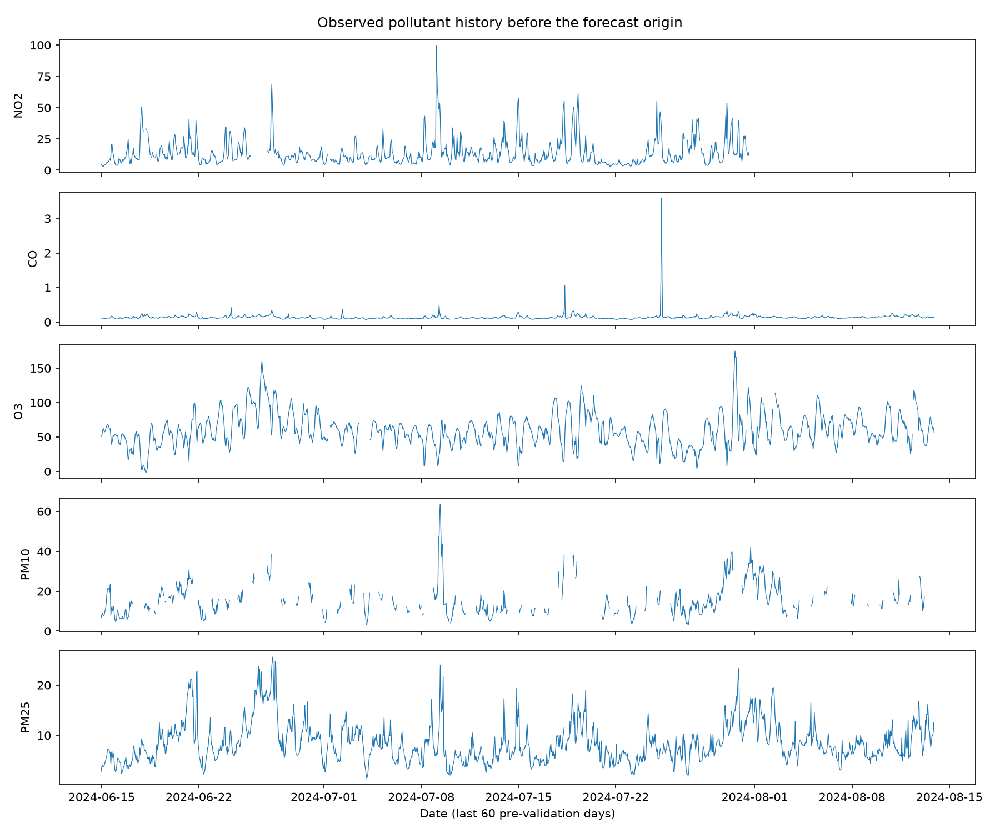
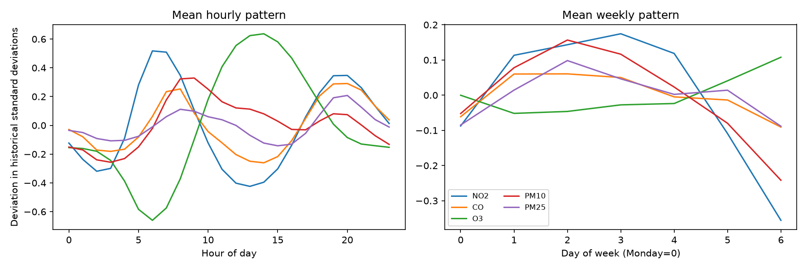
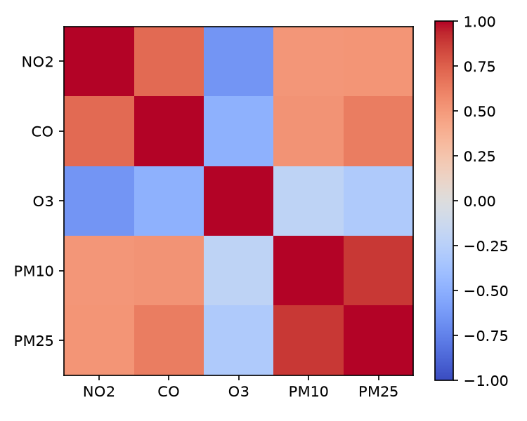
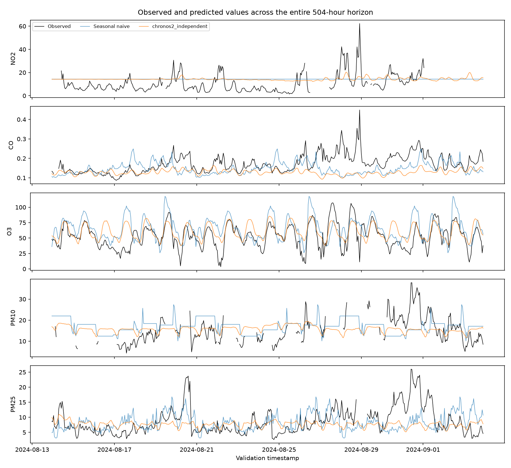

# Paris air-quality forecasting: assignment report

## Task and data

Forecast five pollutants for 504 consecutive hourly test timestamps. Training covers 2020-01-01 00:00:00 to 2024-09-03 22:00:00; the holdout is 2024-08-13 23:00:00 to 2024-09-03 22:00:00. Timestamps come from the `id` column. The loader verifies ascending order, unique timestamps and contiguous hourly rows.

| Pollutant | Observed | Missing | Mean | Median | 1st–99th percentile | Min–max |
| --- | ---: | ---: | ---: | ---: | ---: | ---: |
| valeur_NO2 | 37,300 | 3,187 | 22.0 | 17.7 | 4.5–71.5 | 1.1–131.0 |
| valeur_CO | 27,964 | 12,523 | 0.201 | 0.177 | 0.088–0.587 | 0.037–4.309 |
| valeur_O3 | 39,794 | 693 | 50.5 | 50.7 | 0.7–123.4 | -1.9–193.1 |
| valeur_PM10 | 33,525 | 6,962 | 18.3 | 15.6 | 3.2–59.3 | 0.5–128.5 |
| valeur_PM25 | 38,709 | 1,778 | 11.1 | 8.7 | 1.7–41.3 | 0.0–111.1 |

Values outside the central 1st–99th percentile range are inspected as possible extremes, not deleted automatically. Pollution peaks can be real; CO has a particularly long missing history. O3 includes a small negative value, so blind nonnegative clipping could change the benchmark.

The hourly averages show a daily pattern and the weekday averages show a smaller weekly pattern. The raw series contains sharp peaks and level changes. NO2 and CO are positively associated; O3 is negatively associated with them. Correlations are descriptive, not proof that one pollutant causes another.

## Validation and leakage control

This is forecasting because target values after the forecast origin are unavailable at prediction time and errors can propagate through a 21-day horizon. A random row split mixes earlier and later hours and places near-duplicate seasonal observations on both sides; it would overstate future forecasting skill. The final 504 training hours form one contiguous validation window. Every method sees only observations through the cutoff. Missing inputs are filled by forward fill within that history, with a historical median fallback. Interpolating across validation or test would use unseen future pollutant measurements. No future weather observations are used.

Persistence repeats the last available value; the seasonal naïve method repeats the last 168-hour week three times. A 168-hour lag preserves the hour of day and weekday, relevant to traffic and activity cycles. Scores omit missing validation labels per target, and then average the five target MAEs equally. Per-target MAE is essential because pollutant scales and dynamics differ; the mean can hide a regression for an individual pollutant.

## Models and results

Chronos-2 is a pretrained time-series foundation model: its representations come from broad pretraining rather than fitting on this Paris dataset. Zero-shot means the downloaded model weights are used without fine-tuning here. Independent mode treats each pollutant as a separate series; joint mode gives all five to a single multivariate call. Joint forecasting can use their cross-series relationships, but can suffer from mismatched scales or correlations that change over time. The point forecast is the 0.5 quantile (median), which minimizes expected absolute error. The comparison LSTM is trained only on pre-cutoff pollutant history and recursively predicts 24-hour blocks.

Chronos-2 package 2.3.2, checkpoint revision `29ec3766d36d6f73f0696f85560a422f50e8498c`, 2,048 context hours, 504 output hours, quantile 0.5, batch size 8. Hardware: NVIDIA GeForce RTX 4050 Laptop GPU; PyTorch 2.14.1+cu130. Independent inference took 0.59s after model loading and used 496 MiB peak allocated GPU memory. The runtime table includes import, checkpoint loading and forecasting; the first Chronos method pays cold-start costs, so those two wall times are not directly comparable.

| Method | NO2 | CO | O3 | PM10 | PM2.5 | Mean MAE | Runtime |
| --- | ---: | ---: | ---: | ---: | ---: | ---: | ---: |
| chronos2_independent | 7.206 | 0.046 | 12.970 | 5.054 | 3.228 | **5.701** | 19.7s |
| chronos2_joint | 7.451 | 0.041 | 13.106 | 5.315 | 3.359 | **5.854** | 1.2s |
| lstm_joint | 7.700 | 0.032 | 16.348 | 5.158 | 3.282 | **6.504** | 19.6s |
| persistence | 7.429 | 0.046 | 16.160 | 5.622 | 4.237 | **6.699** | 0.0s |
| seasonal_naive_168h | 7.429 | 0.044 | 17.290 | 6.044 | 3.555 | **6.872** | 0.0s |

The lowest mean MAE is **chronos2_independent**. Best by pollutant: NO2: chronos2_independent; CO: lstm_joint; O3: chronos2_independent; PM10: chronos2_independent; PM25: chronos2_independent. This demonstrates why a single average is insufficient.

### Horizon behavior

| Method | Week 1 | Week 2 | Week 3 |
| --- | ---: | ---: | ---: |
| persistence | 6.335 | 6.969 | 6.808 |
| seasonal_naive_168h | 6.566 | 6.704 | 7.305 |
| lstm_joint | 5.712 | 6.318 | 7.298 |
| chronos2_independent | 5.326 | 5.449 | 6.270 |
| chronos2_joint | 5.375 | 5.797 | 6.354 |

A concrete failure is the O3 peak at 2024-08-27 14:00:00: observed 107.0, independent Chronos-2 predicted 77.6. The weekly errors above show whether forecasts deteriorate between the beginning and end of the horizon. Specific Chronos-2 losses to the 168-hour seasonal baseline by pollutant: chronos2_independent: valeur_CO; chronos2_joint: valeur_NO2.

## Covariates, limits and final forecast

Pollutant history is the target history. Historical weather is a past-only covariate. Hour of day is known in the future. Future *observed* weather is not known at the forecast origin and is prohibited here; a separately issued weather forecast would be a different future-available input, but none is used. The data limitation is long gaps and possible sensor changes; the evaluation limitation is one 21-day holdout, which has high seasonal uncertainty; the model limitation is that a zero-shot model is not adapted to Paris-specific events, while the small LSTM compounds recursive errors.

The final method was selected solely by validation mean MAE: **chronos2_independent**. Its full-history test forecast is in `outputs/assignment/assignment_submission.csv`; the export checks all 504 rows, exact ID order, five target columns and finite values.

The foundation-model experiment was executed on the local machine and the notebook is Colab-ready. A Google Colab session itself is not claimed unless rerun there.

## References

- Ansari et al., [Chronos-2: From Univariate to Universal Forecasting](https://arxiv.org/abs/2510.15821).
- Amazon Science, [Chronos-2 repository and quick start](https://github.com/amazon-science/chronos-forecasting).
- [X/HEC Paris air-quality Kaggle competition](https://www.kaggle.com/competitions/x-hec-ts-2025-predicting-air-quality-in-paris/overview).
